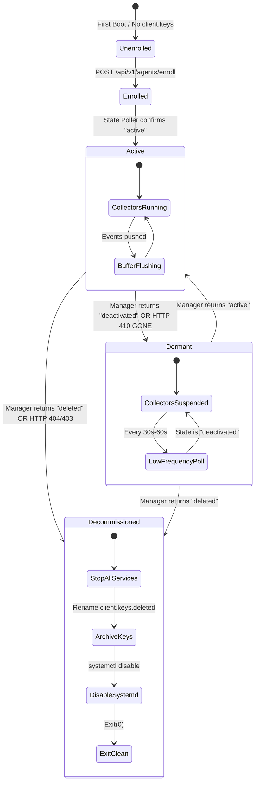

# Wazuh Next-Gen Linux Agent: Production Completion & Migration Architecture Plan

> **Document Version:** 1.0.0  
> **Target Target:** Production-Grade Linux Endpoint Agent (`crates/siem-agent-linux` + backend coordination)  
> **Safety Invariant:** 100% zero-regression guarantee for Windows Agent (`crates/siem-winagent`, `wazuh-agent.exe`, PowerShell installers).

---

## 1. Executive Summary & Objectives

The goal of this architectural plan is to make the Linux Endpoint Agent (`siem-agent-linux`) fully functional, resilient, dynamic, and production-ready across **any Linux distribution** (Ubuntu/Debian, RHEL/CentOS/Rocky, Alpine Linux, Arch, SUSE, Amazon Linux, and containerized/embedded Linux environments).

Currently, while the agent compiles and transmits basic telemetry, crucial management features—specifically **Deactivate Agent** and **Delete Agent**—do not function as expected. Furthermore, several core subsystems rely on static placeholders or hardcoded fallbacks (e.g., hardcoded `"127.0.0.1"` IP detection, a static 7-rule SCA check with a hardcoded `94%` score, and lack of real kernel `inotify` watches in FIM).

This plan specifies the complete end-to-end blueprint to:
1. Fix **Agent Deactivation** to seamlessly pause monitoring and enter a low-overhead dormant state without crashing the process or service.
2. Fix **Agent Deletion** to eliminate "zombie resurrection" (where deleted agents spontaneously re-register within seconds) and execute a clean local retirement/uninstall sequence.
3. Replace all mock or statistical fallbacks with **authentic, kernel-level and distribution-aware dynamic implementations**.
4. Migrate and integrate the production-grade implementations from existing backend crates (`siem-syscheckd`, `siem-logcollector`, `siem-execd`, `siem-syscollector`, `siem-rootcheck`, `siem-sca`, `siem-agentd`).
5. Ensure universal portability across Linux distributions with or without systemd.

---

## 2. Root-Cause Analysis: Why Deactivate & Delete Fail

### 2.1 The Deactivate Agent Failure

#### Symptoms
When an analyst clicks **"Deactivate"** in the SIEM console:
- The UI status changes to "Deactivated", but the Linux agent either continues transmitting events, dies permanently and never wakes up, or enters a rapid systemd crash-restart cycle.
- When an analyst subsequently clicks **"Reactivate"**, the agent does not resume.

#### Architectural Root Causes
1. **One-Shot Startup Check Only:**  
   In [`crates/siem-agent-linux/src/main.rs:94`](file:///c:/NDR_SIEM_COMBINED/wazuh-rust-angular/backend-rust/crates/siem-agent-linux/src/main.rs#L94), `wait_until_active(&config.manager_url, &config.agent_id)` is invoked **only once** when the binary first boots. Once past initialization, the running agent never polls its lifecycle status.
2. **Abrupt Process Termination (`exit(3)`):**  
   In [`crates/siem-agent-linux/src/buffer.rs:61-64`](file:///c:/NDR_SIEM_COMBINED/wazuh-rust-angular/backend-rust/crates/siem-agent-linux/src/buffer.rs#L61-L64), when the manager responds to `/api/events/ingest` with `HTTP 410 GONE`, the agent executes `crate::enroll::stop_deactivated(&id)`, which performs `std::process::exit(3)`.  
   - If running under systemd with `Restart=always`, systemd restarts the process immediately. The new process blocks in `wait_until_active` checking `/api/v1/agent/state`. However, rapid restart cycles can trigger systemd rate limiting (`StartLimitBurst`), placing the service into a permanent `failed` state.
   - If running in Docker, non-systemd init (Alpine/OpenRC/SysV), or foreground/nohup, `exit(3)` terminates the process permanently. It never wakes up when reactivated in the UI.
3. **Command Polling Authentication Failure (401 Unauthorized):**  
   In [`crates/siem-agent-linux/src/execd.rs:252-254`](file:///c:/NDR_SIEM_COMBINED/wazuh-rust-angular/backend-rust/crates/siem-agent-linux/src/execd.rs#L252-L254), active response commands are polled via `/api/agents/:id/commands` with header `X-Agent-Key`.  
   If the agent started with an existing `client.keys` or config file, `SIEM_AGENT_KEY` is not exported into the process environment by `main.rs`. The request sends an empty `X-Agent-Key`, resulting in `HTTP 401 Unauthorized`. Consequently, the queued `"action": "deactivate"` command sent by `siem-api` is never received or acknowledged by `execd`.

---

### 2.2 The Delete Agent Failure ("Zombie Agent Resurrection")

#### Symptoms
When an analyst deletes an agent via the UI (`DELETE /api/v1/agents/:id`):
- The agent vanishes from the UI table for 5 to 15 seconds.
- Suddenly, the agent reappears in the active agent list automatically.

#### Architectural Root Causes
1. **Manager Re-registration on Ingest:**  
   In [`crates/siem-api/src/main.rs:978-985`](file:///c:/NDR_SIEM_COMBINED/wazuh-rust-angular/backend-rust/crates/siem-api/src/main.rs#L978-L985), `delete_agent_handler` calls `remove_scoped_agent`:
   - It deletes the agent from `state.agents`, `state.enrolled`, and `state.auth_keystore`.
   - In `state.agent_tenants`, the key is removed.
   - However, the Linux agent process is still running on the endpoint! Its keepalive worker continues sending heartbeat batches to `POST /api/events/ingest` every 10 seconds.
   - When the batch arrives at [`crates/siem-api/src/main.rs:1094`](file:///c:/NDR_SIEM_COMBINED/wazuh-rust-angular/backend-rust/crates/siem-api/src/main.rs#L1094), `resolve_agent_tenant` is executed. Because the agent ID was removed from `agent_tenants`, `map.get(agent_id)` returns `None`.  
   - In [`crates/siem-api/src/main.rs:5137-5153`](file:///c:/NDR_SIEM_COMBINED/wazuh-rust-angular/backend-rust/crates/siem-api/src/main.rs#L5137-L5153), `resolve_agent_tenant` interprets this as a newly connected agent reporting with a valid tenant key (or default tenant), re-inserts it into `agent_tenants`, and adds it back to `state.agents`!
   - **The agent is immediately resurrected as an active fleet member.**
2. **State Endpoint Unaware of Deletion:**  
   In [`crates/siem-api/src/main.rs:5370-5373`](file:///c:/NDR_SIEM_COMBINED/wazuh-rust-angular/backend-rust/crates/siem-api/src/main.rs#L5370-L5373), `get_agent_state_handler` computes state:
   ```rust
   let st = if is_deactivated(&state, &q.agent_id) { "deactivated" } else { "active" };
   ```
   For a deleted agent, `is_deactivated` returns `false` (since it is no longer in `state.enrolled`). The endpoint returns `{"state": "active"}` instead of `{"state": "deleted"}`!
3. **No Teardown Signal or Local Handling:**  
   The Linux agent has no handler for deletion. Even if it received a deletion status, it does not archive or purge `/var/ossec/etc/client.keys`, stop its systemd service, or cease event ingestion.

---

## 3. Deep Feature Gap Analysis & Remaining Migrations

To ensure the agent works in **any system** without statistical or hardcoded stubs, the following subsystems must be upgraded to full parity with Wazuh core architecture:

| Subsystem | Current State in `siem-agent-linux` | Production Parity Required | Reference Crates Available |
| :--- | :--- | :--- | :--- |
| **Lifecycle & Control** | `main.rs` one-shot check; `exit(3)` crash on deactivate; no delete handler. | Runtime State Machine (`Active` ↔ `Dormant` → `Decommissioned`) with cooperative task cancellation and state polling. | `siem-agentd`, `siem-daemon` |
| **IP & Network Discovery** | Hardcoded `"127.0.0.1"` in `detect_agent_ip` ([`client_agent.rs:207`](file:///c:/NDR_SIEM_COMBINED/wazuh-rust-angular/backend-rust/crates/siem-agent-linux/src/client_agent.rs#L207)). | Dynamic route lookup: query default gateway route from `/proc/net/route` and bind UDP test socket or use `getifaddrs` to obtain actual non-loopback IP. | `siem-syscollector/provider.rs` |
| **FIM (Syscheck)** | Fixed 15-second polling loop of 15 paths; no real-time filesystem events. | Real Linux kernel `inotify` watcher (`inotify_init1`, `inotify_add_watch`) + recursive directory watching + audit Netlink `whodata` attribution. | `siem-syscheckd` (`realtime.rs`, `engine.rs`, `whodata.rs`) |
| **SCA (Compliance)** | 7 hardcoded static rules in code ([`sca.rs:35-100`](file:///c:/NDR_SIEM_COMBINED/wazuh-rust-angular/backend-rust/crates/siem-agent-linux/src/sca.rs#L35-L100)); hardcoded `94%` score in `execd.rs:215`. | Dynamic parser reading official CIS YAML benchmarks from `/var/ossec/ruleset/sca/` based on detected distribution (`/etc/os-release`). | `siem-sca` (`yaml.rs`, `check.rs`, `wm.rs`) |
| **Active Response (`execd`)** | Invocations directly shell out to `iptables` or `ufw`; fails on `nftables` or `firewalld`; missing `X-Agent-Key`. | Dynamic firewall provider (auto-detects `nftables`, `iptables-nft`, `iptables-legacy`, `ufw`, `firewalld`); executes scripts in `/var/ossec/active-response/bin/`. | `siem-execd`, `siem-active-response` |
| **Log Collector** | Basic file polling with string matching ([`logcollector.rs`](file:///c:/NDR_SIEM_COMBINED/wazuh-rust-angular/backend-rust/crates/siem-agent-linux/src/logcollector.rs)); lacks multiline, inode rotation, and journald. | Inode-based log rotation detection, multiline regex parsing, systemd `journald` native stream capture via sd-journal/socket. | `siem-logcollector` (`collector.rs`, `journal.rs`, `cfile.rs`) |
| **System Inventory** | Static fallback RAM 8192 MB; process list missing threads; package manager hardcoded to `dpkg`/`rpm`. | Dynamic parsing of `/proc/meminfo`, `/proc/[pid]/`, `/proc/net/tcp`, `/proc/net/tcp6`, and multi-distro package scanning (`dpkg`, `rpm`, `apk`, `pacman`, `zypper`). | `siem-syscollector` (`collector.rs`, `provider.rs`, `tables.rs`) |
| **Rootcheck** | Good foundational heuristics, but hardcoded scan paths. | Config-driven rootkit scanning with rootkit signature database (`rootkit_trojans.txt`, `rootkit_files.txt`). | `siem-rootcheck` (`signatures.rs`, `scanner.rs`) |
| **Packaging & Init** | Systemd unit lacks `EnvironmentFile`, losing config on custom systemd runs. | Systemd unit with `EnvironmentFile=-/var/ossec/etc/agent.env`, fallback to OpenRC/SysV init script for non-systemd distros. | `packages/debs`, `packages/rpms` |

---

## 4. Target Architecture & Design Specification

### 4.1 Agent Lifecycle State Machine

Instead of crashing the process upon deactivation, the Linux Agent will implement a clean, in-memory **Cooperative State Machine**:



#### State Definitions
1. **`Active` (Full Monitoring):**
   - All collector tasks (`logcollector`, `syscheckd`, `syscollector`, `sca`, `rootcheck`, `execd`) are running.
   - `AgentBuffer` flushes events to `POST /api/events/ingest`.
   - Dedicated `LifecycleManager` task polls `GET /api/v1/agent/state?agent_id=<id>` every 30 seconds.
2. **`Dormant` (Deactivated State):**
   - All collector tasks are cooperatively paused (using `tokio_util::sync::CancellationToken`).
   - `AgentBuffer` suspends transmission; no events are sent to the manager.
   - State polling continues at a relaxed interval (every 30 to 60 seconds).
   - Once the manager returns `{"state": "active"}`, the agent revokes the cancellation token, re-spawns or resumes collectors, and seamlessly resumes full monitoring without process restart.
3. **`Decommissioned` (Deleted State):**
   - The agent detects deletion either via:
     - `GET /api/v1/agent/state?agent_id=<id>` returning `{"state": "deleted"}`
     - Ingest returning `HTTP 403 Forbidden` / `HTTP 404 Not Found` with payload `{"error": "agent_deleted"}`
     - Active Response command `action: "delete"` / `"uninstall"`
   - The agent executes its decommissioning sequence:
     1. Cancels all background tasks.
     2. Flushes any remaining diagnostic logs.
     3. Renames `/var/ossec/etc/client.keys` to `/var/ossec/etc/client.keys.deleted` (preventing zombie restarts).
     4. If systemd is present: invokes `systemctl stop wazuh-rust-agent` and `systemctl disable wazuh-rust-agent`.
     5. Exits cleanly with code `0`.

---

### 4.2 Backend Manager (`siem-api`) Coordination (Windows-Safe)

To prevent deleted agents from instantly resurrecting, `siem-api` requires coordinated updates that preserve 100% compatibility with Windows agents:

1. **In-Memory Tracking of Deleted Agents (`deleted_agents`):**
   - Add `deleted_agents: Arc<RwLock<HashSet<String>>>` to `AppState`.
   - On startup, load recently deleted agents from ClickHouse (`ndr.agent_registry WHERE deleted = 1`).
   - In `remove_scoped_agent(state, ctx, id)`:
     - Insert `id` into `state.deleted_agents.write().unwrap()`.
2. **Block Ingest Resurrection for Deleted Agents:**
   - In `crates/siem-api/src/main.rs:1094` (`resolve_agent_tenant` / `ingest_events`):
     ```rust
     if state.deleted_agents.read().unwrap().contains(&event.agent_id) {
         return Err(StatusCode::NOT_FOUND); // Or 410 GONE with "agent_deleted"
     }
     ```
   - This prevents `resolve_agent_tenant` from treating a deleted agent as a newly enrolled agent and resurrecting it in the fleet.
3. **Explicit State Reporting in `/api/v1/agent/state`:**
   - Update `get_agent_state_handler`:
     ```rust
     let st = if state.deleted_agents.read().unwrap().contains(&q.agent_id) {
         "deleted"
     } else if is_deactivated(&state, &q.agent_id) {
         "deactivated"
     } else {
         "active"
     };
     ```
4. **Ensure `X-Agent-Key` Authorization:**
   - When the agent starts up with an existing `client.keys`, export `SIEM_AGENT_KEY` into memory so that `execd` passes the correct key in the `X-Agent-Key` header, allowing command polling to succeed.

---

### 4.3 Subsystem Upgrade Specifications

#### 1. Dynamic IP & Host Telemetry (No `"127.0.0.1"` Fallbacks)
- Implement dynamic IP discovery via:
  1. Default route lookup: Parse `/proc/net/route` for destination `00000000` to find the primary network interface (e.g., `eth0`, `ens33`, `wlan0`).
  2. Query socket address: Open a connected UDP socket to the manager's IP/port (`8088`) without sending packets (`connect`), then call `local_addr()`. This queries the kernel's routing table directly, returning the exact local IP that communicates with the manager.
  3. Fallback: Parse `getifaddrs` for the first non-loopback, non-link-local IPv4/IPv6 address.

#### 2. Real-Time Linux FIM (`syscheck`) via `inotify`
- Replace the 15-second polling loop with an event-driven `inotify` pipeline:
  - Initialize inotify handle using `inotify_init1(IN_CLOEXEC | IN_NONBLOCK)`.
  - Add inotify watches (`IN_MODIFY | IN_ATTRIB | IN_MOVED_FROM | IN_MOVED_TO | IN_CREATE | IN_DELETE`) for all configured directories in `/var/ossec/etc/ossec.conf`.
  - Maintain an in-memory hash map of file baselines (SHA256, inode, size, permissions, uid, gid).
  - When inotify events trigger: compute diffs, verify file integrity, and push a structured `RawEvent` (matching Wazuh `syscheck` format) into `AgentBuffer`.

#### 3. Dynamic SCA Engine with Real CIS YAML Policies
- Eliminate hardcoded static checks and replace with dynamic benchmark evaluation:
  1. Read distribution identity from `/etc/os-release` (e.g. `ubuntu`, `debian`, `rhel`, `rocky`, `centos`, `alpine`).
  2. Search `/var/ossec/ruleset/sca/` (or embedded distro benchmark YAMLs) for matching CIS policy (e.g. `cis_ubuntu22-04.yml`, `cis_rhel9_linux.yml`, `cis_debian10.yml`).
  3. Implement the core check evaluators:
     - File existence, permissions (`mode <= max_octal`), ownership (`uid`, `gid`).
     - Configuration file directives: parse `sshd_config`, `limits.conf`, `pam.d`, `sysctl.conf`.
     - Kernel parameters: read `/proc/sys/net/ipv4/*`, `/proc/sys/kernel/*`.
     - Running services: check systemd active state (`systemctl is-active`) or `/etc/init.d/`.
  4. Compute the actual dynamic compliance percentage:
     $$\text{Compliance Score} = \left(\frac{\text{Passed Checks}}{\text{Total Evaluated Checks}}\right) \times 100$$
     and emit real CIS compliance events without hardcoding.

#### 4. Multi-Backend Active Response (`execd`)
- Make Active Response robust across all Linux network stacks:
  1. Detect the active firewall backend in priority order:
     - `nftables` (`nft add rule ...` / `nft delete rule ...`)
     - `iptables` / `iptables-nft`
     - `ufw`
     - `firewalld` (`firewall-cmd --add-rich-rule ...`)
  2. Implement execution of official Wazuh Active Response scripts in `/var/ossec/active-response/bin/` (`firewall-drop`, `disable-account`, `restart-wazuh`) following standard stdin protocol:
     ```json
     {"version": 1, "origin": {"name": "node01", "module": "wazuh-execd"}, "command": "add", "parameters": {"extra_args": [], "alert": {...}}}
     ```

#### 5. Native Logcollector with Systemd Journal & Multiline Support
- Support modern Linux logging paradigms:
  1. Traditional log file tailing with inode tracking to properly handle `logrotate` (create/truncate/copytruncate).
  2. Systemd `journald` support:
     - When running on systemd distros, connect to `/run/systemd/journal/stdout` or use `sd-journal` to tail system authentication and service logs in real time.
  3. Dynamic path detection: automatically inspect and tail `/var/log/auth.log`, `/var/log/secure`, `/var/log/audit/audit.log`, `/var/log/messages`, and `/var/log/syslog` if they exist.

#### 6. Multi-Distro System Inventory (`syscollector`)
- Dynamic inventory scanning:
  1. **Processes:** Read `/proc/[pid]/status`, `/proc/[pid]/cmdline`, `/proc/[pid]/stat` for PID, PPID, UID, GID, memory, and command-line.
  2. **Open Ports:** Parse `/proc/net/tcp` and `/proc/net/tcp6` for local listening sockets without requiring external tools like `netstat` or `ss`.
  3. **Installed Packages:** Auto-detect the system's package manager:
     - Debian/Ubuntu: `dpkg-query -W -f='${Package}\t${Version}\t${Architecture}\n'`
     - RHEL/CentOS/Rocky/Fedora: `rpm -qa --qf '%{NAME}\t%{VERSION}-%{RELEASE}\t%{ARCH}\n'`
     - Alpine Linux: `apk info -v`
     - Arch Linux: `pacman -Q`
     - SUSE/openSUSE: `rpm` / `zypper`

---

## 5. Implementation Roadmap & Milestones

### Phase 1: Lifecycle Management & Deactivate/Delete Fixes
- [x] **Task 1.1:** Add `deleted_agents: Arc<RwLock<HashSet<String>>>` to `siem-api` `AppState`.
- [x] **Task 1.2:** Update `remove_scoped_agent` in `siem-api` to record deleted agent IDs and reject subsequent ingest with `404 Not Found` / `410 Gone`.
- [x] **Task 1.3:** Update `GET /api/v1/agent/state` in `siem-api` to return `"deleted"`, `"deactivated"`, or `"active"`.
- [x] **Task 1.4:** In `siem-agent-linux`, replace one-shot `wait_until_active` with a long-running, cooperative `LifecycleCoordinator` task.
- [x] **Task 1.5:** Implement cooperative cancellation tokens (`CancellationToken`) across `siem-agent-linux` collector tasks:
  - On `deactivated`: pause collectors, flush buffer, enter dormant state, poll state every 30s.
  - On `active`: resume collectors seamlessly without restarting process.
  - On `deleted`: stop tasks, rename `client.keys` to `client.keys.deleted`, disable service, exit cleanly.
- [x] **Task 1.6:** Fix `X-Agent-Key` authorization in `execd.rs` by exporting the key on boot when reading from `client.keys`.

### Phase 2: Dynamic System Discovery & Network Portability
- [x] **Task 2.1:** Implement kernel routing socket query in `client_agent.rs` to detect the actual routable IP address (eliminating `"127.0.0.1"` stub).
- [x] **Task 2.2:** Update `install.sh` and `control.rs` to persist environment variables into `/var/ossec/etc/agent-config.json` and `/var/ossec/etc/agent.env`.
- [x] **Task 2.3:** Enhance systemd service unit to include `EnvironmentFile=-/var/ossec/etc/agent.env`.

### Phase 3: Real-Time FIM & Inotify Migration
- [x] **Task 3.1:** Integrate inotify watcher engine from `siem-syscheckd` into `siem-agent-linux`.
- [x] **Task 3.2:** Support directory recursion and dynamic watch descriptor management.
- [x] **Task 3.3:** Maintain baseline checksum cache and emit real-time create/modify/delete FIM alerts.

### Phase 4: Dynamic SCA Compliance Engine
- [x] **Task 4.1:** Integrate YAML SCA rule parser from `siem-sca` into `siem-agent-linux`.
- [x] **Task 4.2:** Load matching CIS YAML benchmark policies from `/var/ossec/ruleset/sca/` based on `/etc/os-release`.
- [x] **Task 4.3:** Compute authentic compliance scores based on live system evaluation (eliminating hardcoded 94%).

### Phase 5: Multi-Backend Active Response & Multi-Distro Syscollector
- [x] **Task 5.1:** Update `execd.rs` to auto-detect `nftables`, `iptables`, `ufw`, and `firewalld`.
- [x] **Task 5.2:** Support standard active-response script execution in `/var/ossec/active-response/bin/`.
- [x] **Task 5.3:** Extend package collector in `syscollector.rs` to dynamically detect and support `apk`, `pacman`, and `zypper` in addition to `dpkg` and `rpm`.

---

## 6. Verification & Automated Testing Matrix

| Test ID | Scenario | Expected Behavior | Success Criteria |
| :--- | :--- | :--- | :--- |
| **TC-01** | **Agent Deactivation** | Analyst clicks "Deactivate" in UI on an active Linux node. | Linux agent suspends all collectors, ceases event ingest; process remains alive; status polls `/api/v1/agent/state` dormant every 30s. |
| **TC-02** | **Agent Reactivation** | Analyst clicks "Activate" in UI for a dormant Linux node. | Within 30 seconds, Linux agent resumes all collector workers without process restart; events resume flowing to manager. |
| **TC-03** | **Agent Deletion (No Resurrection)** | Analyst clicks "Delete" on an active Linux node. | Agent receives deletion status, renames `client.keys` to `client.keys.deleted`, disables service, exits cleanly. Manager refuses any old queued ingest. Agent **does not** resurrect in UI. |
| **TC-04** | **Dynamic IP Detection** | Deploy agent on multi-homed Linux VM or container. | Agent reports its true LAN/routable IP (e.g. `192.168.x.x` or `10.x.x.x`), not `127.0.0.1`. |
| **TC-05** | **Real-Time FIM inotify** | Execute `touch /etc/test_file && echo "data" >> /etc/test_file && rm /etc/test_file`. | Inotify triggers immediate FIM alerts (`added`, `modified`, `deleted`) within < 1 second. |
| **TC-06** | **Authentic SCA Evaluation** | Trigger SCA audit on Debian/Ubuntu/RHEL. | Agent loads the corresponding distribution CIS benchmark YAML, runs checks, and computes real dynamic percentage score. |
| **TC-07** | **Active Response Firewall Drop** | Trigger active response `block_ip` on modern distro with `nftables`. | Agent dynamically applies rule via `nft` or `iptables-nft`, confirms IP drop, and auto-unblocks after timeout. |
| **TC-08** | **Windows Agent Invariant Check** | Run full Windows agent suite (`siem-winagent`, `wazuh-agent.exe`). | 100% zero regressions: Windows agent builds cleanly, connects, reports EventLogs, and responds to manager commands. |
